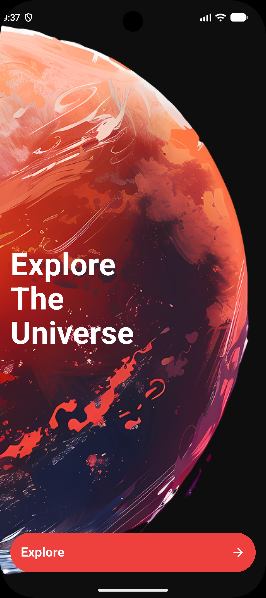
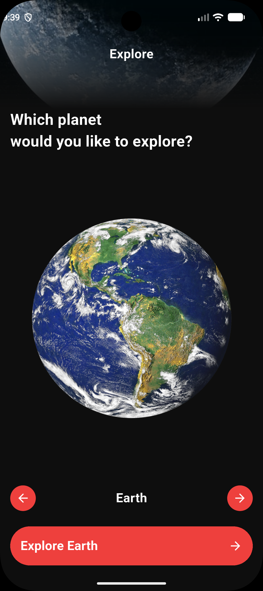
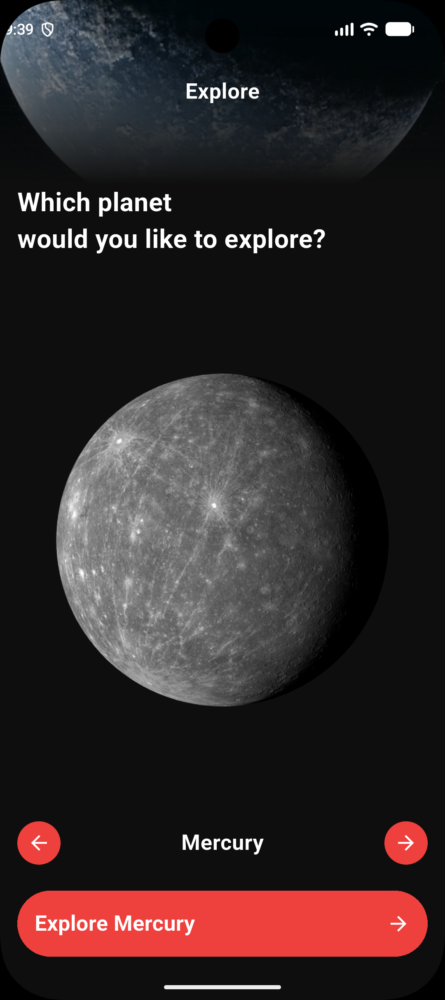
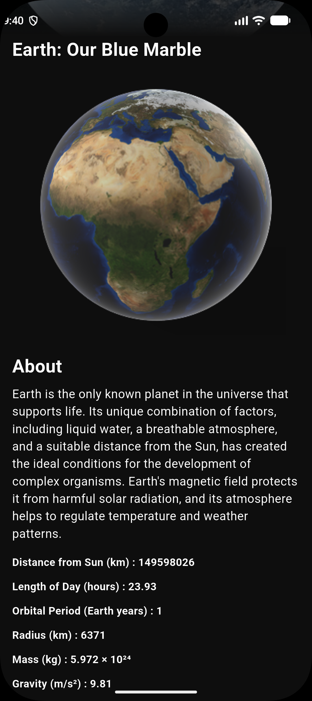

# Space Explorer App

A Flutter app for exploring the planets of the solar system, built for the **Route Mobile Diploma**. Swipe through the planets, then open any planet to see its details, key facts and an interactive 3D model.

## Features

- Welcome screen with a full-screen planet background
- Home screen with a swipeable planet carousel (`PageView`) and a scale animation while swiping
- Previous and next arrow buttons that stay in sync with the swipe
- "Explore" button that always shows the name of the selected planet
- Planet details screen with a title, an **About** section and key facts:
  distance from the Sun, length of day, orbital period, radius, mass, gravity and surface area
- Interactive **3D model** of the planet using `flutter_3d_controller`
  (falls back to the planet image when no 3D model is available)
- Reusable stacked header (image + gradient + title) shared by the Home and Details screens
- 9 celestial bodies: Sun, Mercury, Venus, Earth, Mars, Jupiter, Saturn, Uranus and Neptune

## Screenshots

| Welcome | Home | Home (another planet) | Planet Details |
|:---:|:---:|:---:|:---:|
|  |  |  |  |

## Demo

[Watch the screen recording](https://drive.google.com/file/d/1pzf3qb5AAg7gGvOI7LofcaU-tFimn5xH/view?usp=sharing)

## Tech Stack

- Flutter & Dart
- [flutter_3d_controller](https://pub.dev/packages/flutter_3d_controller)

## Project Structure

```
lib/
├── core/        # colors and asset paths
├── data/        # planets data
├── models/      # PlanetModel
├── screens/     # welcome, home and planet details screens
└── widgets/     # reusable UI components (header, buttons)
assets/
├── images/      # planet images and backgrounds
└── models/      # 3D models (.glb)
```

## Getting Started

This repository contains the `lib`, `assets` and `pubspec.yaml` files only. To run it:

```bash
flutter create space_app
# copy lib/, assets/ and pubspec.yaml into the new project
flutter pub get
flutter run
```

> The 3D viewer works on **Android and iOS** only, so run the app on an emulator or a real device (not Windows or web).

## Data Source

Planet descriptions and facts come from the course data sheet provided with the task.

## Author

**Nada Abdelazim** — Route Mobile Diploma
